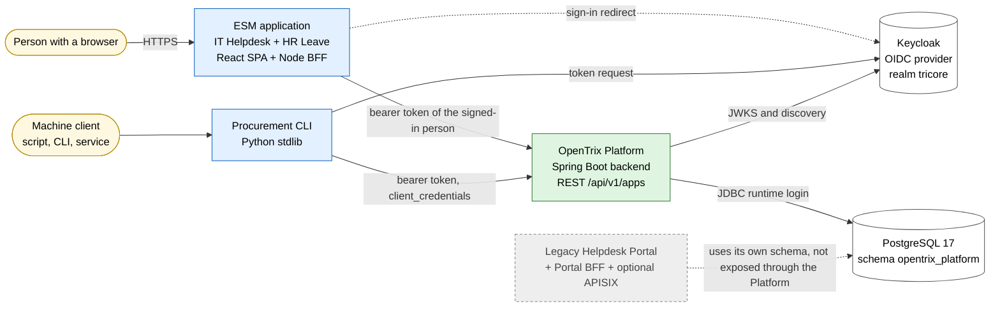
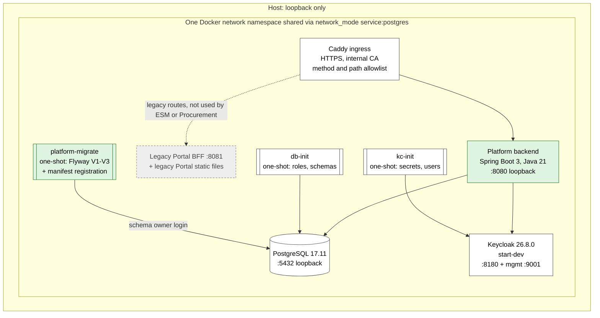
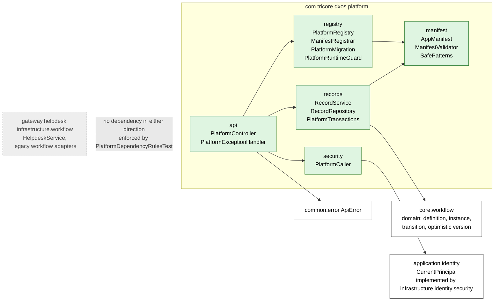
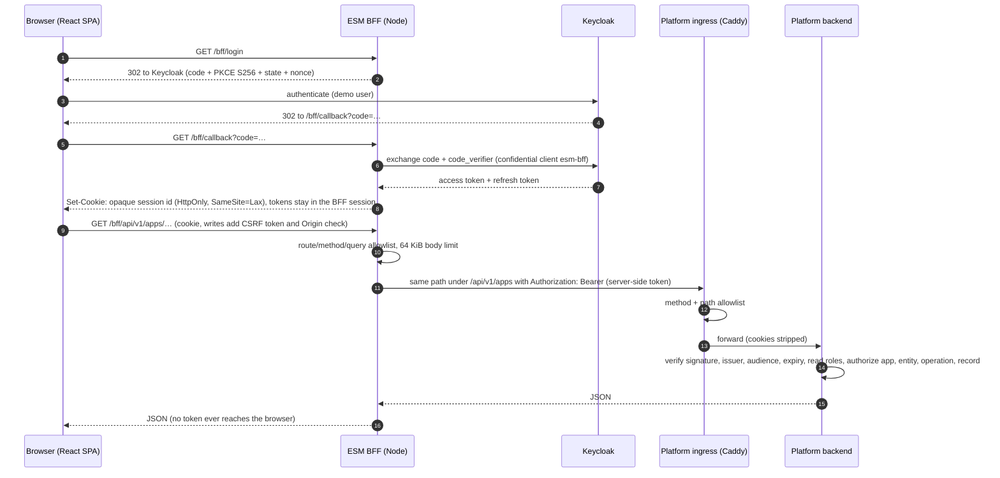
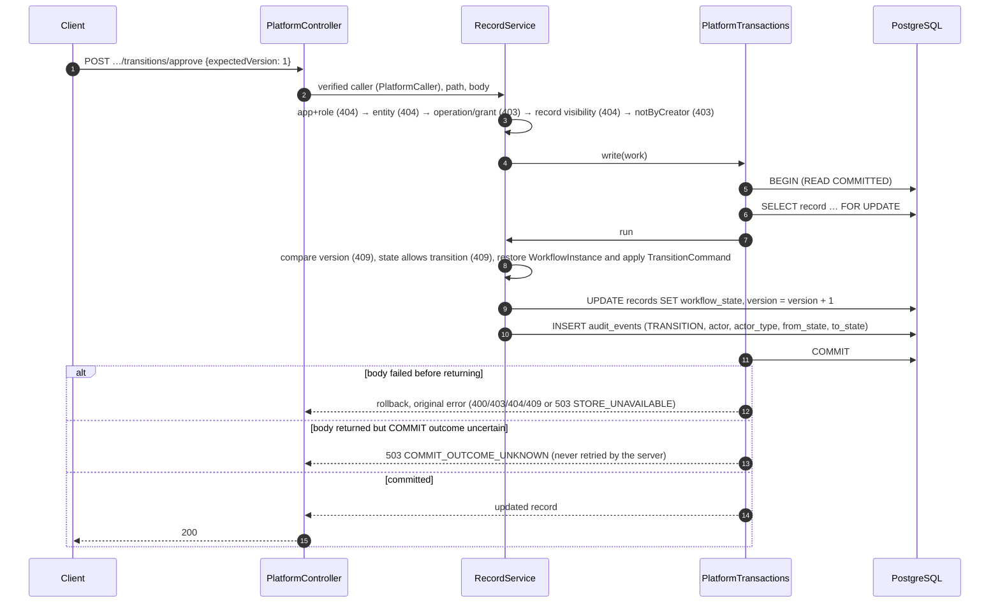
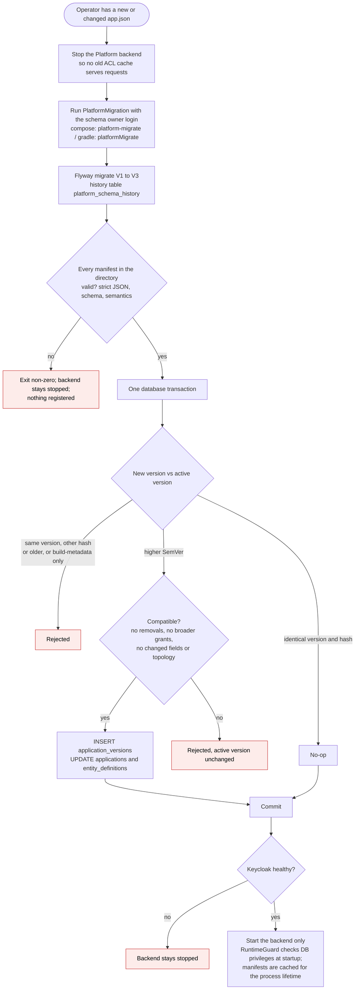
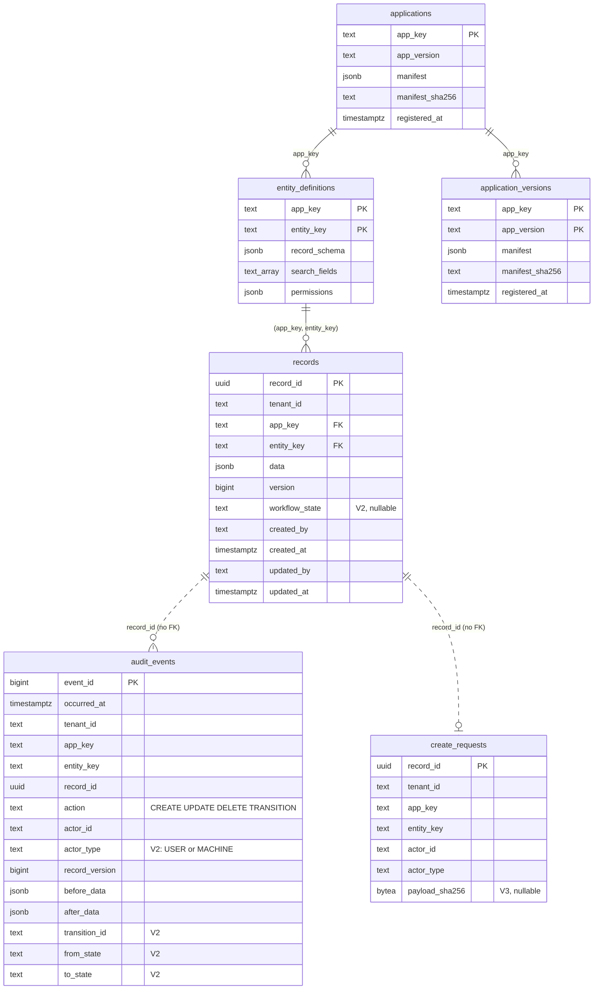
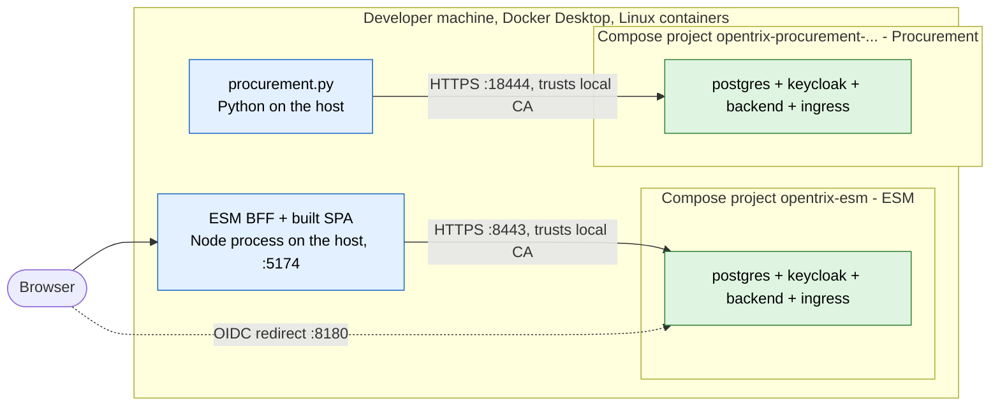

<!--
SPDX-FileCopyrightText: 2026 TRICORE contributors
SPDX-License-Identifier: Apache-2.0
-->

# Architecture of the candidate Platform

Diagrams are Mermaid (rendered by GitHub; the source is plain text and reviewable). They show **only components that
exist** in this repository or in the sibling application repositories. Colour key used throughout:

- **green** = new candidate Platform architecture (package `com.tricore.dxos.platform`, schema `opentrix_platform`, API `/api/v1/apps`)
- **blue** = independent applications built on the public contract (ESM, Procurement)
- **grey, dashed** = legacy upstream components that still exist in the repository but are **not** part of the Platform API
- **white** = third-party infrastructure

The legacy modular monolith, its Helpdesk and the Portal are described by the upstream documents
([../ARCHITECTURE.md](../ARCHITECTURE.md)). The candidate decisions are in
[ADR-C001](../08-decisions/ADR-C001-candidate-platform-baseline.md).

## 1. System context

Applications reach the Platform **only** through HTTPS and the OpenAPI v1 contract. Neither ESM nor Procurement has a
database connection to the Platform. The browser never holds an access token (ESM BFF keeps it server side).

## 2. Containers (demo deployment)

- Published to the host: ingress HTTPS (and, for ESM, Keycloak `8180` for the browser redirect). Backend and PostgreSQL
  listen on loopback inside the shared namespace only.
- The ESM and Procurement stacks start `postgres`, `keycloak`, `backend`, `ingress` and the three one-shot jobs. They do
  **not** start the legacy Portal BFF. The legacy components appear in the base Compose file only.
- Start order is enforced by Compose: `db-init` and `platform-migrate` complete, then the backend starts once Keycloak is
  `service_healthy`.

## 3. Platform module boundaries

`core.workflow` is the pre-existing domain model (immutable definitions, instances, optimistic `runtimeVersion`) reused
as a library. The Platform does **not** use the legacy workflow controller (it stays unregistered) nor the legacy
workflow tables. The Platform keeps a record's workflow state on the record row.

## 4. ESM authentication flow

The BFF is an optimisation and a safety layer, **not** the authority: the Platform authorizes every call from the
verified token. Sessions are in memory (single instance, lost on restart).

## 5. Record and workflow write transaction

For **create**, the same transaction also inserts the `create_requests` reservation (UUID, tenant, app, entity, actor and
payload fingerprint). Platform writes refuse to run inside an externally managed transaction.

## 6. Manifest registration and upgrade flow

## 7. Database model (migrations V1, V2, V3)

Schema `opentrix_platform`. The runtime login has only the privileges shown in the last column; DDL belongs to the
schema owner role used by `platform-migrate`.

| Table | Created in | Runtime privilege |
| --- | --- | --- |
| `applications`, `entity_definitions`, `platform_schema_history` | V1 | SELECT |
| `application_versions` | V3 (backfilled from `applications`) | SELECT |
| `records` | V1 (`workflow_state` added in V2) | SELECT, INSERT, UPDATE, DELETE |
| `audit_events` | V1 (extended in V2) | SELECT, INSERT |
| `create_requests` | V3 (backfilled from audit and records, without fingerprints) | SELECT, INSERT |

Constraints worth knowing: `records.data` must be a JSON object of at most 65,536 bytes; `audit_events` has CHECK
constraints that tie each `action` to the shape of its before/after/transition columns; the foreign key
`records(app_key, entity_key) → entity_definitions` blocks removal of an entity that still has records.
The legacy Helpdesk and Workflow schema (`helpdesk_demo`, Flyway history pinned to V1 to V4) is separate and untouched.

## 8. Deployment topology

- Each stack is its own Compose project with its own PostgreSQL volume, Keycloak container and CA. Two stacks run side
  by side only when `ESM_*` or `M5_*` ports and project names differ (verified in M6.1-FIX).
- Nothing listens on a non-loopback interface. There is no cloud, Kubernetes, load balancer or replicated database in
  this candidate and none is drawn here.
- ESM and Procurement run on the host, outside the containers; only the Platform stack is containerised.
